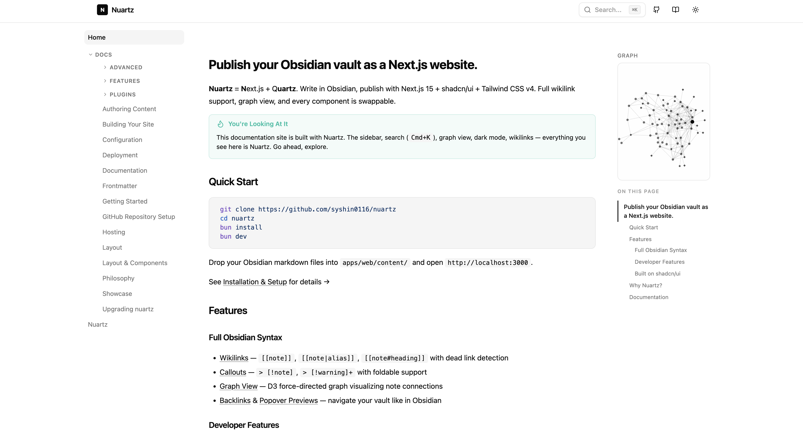

<div align="center">

# Nuartz

**A free, open-source Obsidian Publish alternative built on Next.js.**

[](https://www.npmjs.com/package/nuartz)
[](https://github.com/syshin0116/nuartz/actions/workflows/ci.yml)
[](https://opensource.org/licenses/MIT)

[Documentation & Demo](https://nuartz.vercel.app) · [Use Case](https://syshin0116.vercel.app/blog) · [npm](https://www.npmjs.com/package/nuartz)

[](https://nuartz.vercel.app)

</div>

Nuartz turns an Obsidian vault into a Next.js 16 site built with **shadcn/ui** and **Tailwind CSS v4**. Wikilinks, embeds, callouts, backlinks, tags and the graph work as they do in Obsidian, and every page is ordinary React you can change.

It is heavily inspired by [Quartz](https://github.com/jackyzha0/quartz), which pioneered Obsidian-to-website publishing. The difference is the stack: Nuartz is a normal Next.js app plus a headless library, so you get the React ecosystem, components from [ui.shadcn.com](https://ui.shadcn.com), and every place Next.js deploys.

## Who is this for?

- **Obsidian users** who want to publish a vault without losing wikilinks, callouts, embeds, or the graph
- **Next.js developers** who want a garden or blog inside an existing app, not a separate tool
- **Quartz users** who want to customize the UI with React instead of a theme system

## How it works

| Layer | What it is | How to use it |
|-------|-----------|---------------|
| **`nuartz` (npm package)** | Headless library: Obsidian Markdown to HTML, note and attachment resolution, file trees, backlinks, search data | `bun add nuartz` and call it at build time |
| **`apps/web` (starter)** | Complete Next.js 16 site: sidebar, graph, search, previews, dark mode | Clone the repo, add notes, deploy |

Most people start with the starter. To add a garden to an existing Next.js app, use the package.

## Features

- **Obsidian syntax**: wikilinks with headings and aliases, standard Markdown links to notes, note and block embeds (`![[note#^id]]`), image sizes (`![[img.png|300]]`), video, audio, PDF and YouTube embeds, foldable and custom callouts, nested tags, `==highlights==`, `%%comments%%`, Mermaid, D2, Graphviz, KaTeX
- **Canvas and Bases**: `.canvas` files become pannable, zoomable pages; `.base` files and ```` ```base ```` blocks render table, card, and list views over your notes
- **Attachments like Obsidian**: `![[photo.png]]` is found by file name anywhere in the vault
- **Graph**: 2D force graph with two-hop exploration, plus 3D, VR, and marker-based AR views
- **Navigation**: `Cmd+K` full-text search (Pagefind), backlinks, hover previews, folder pages from `index.md`, tag pages, breadcrumbs, previous and next links, alias redirects
- **For AI agents**: every note as Markdown at `/md/<slug>.md`, `Accept: text/markdown` negotiation, `llms.txt` and `llms-full.txt`, and a read-only MCP server at `/api/mcp`
- **Publishing**: drafts, `_private` and dot-folders (`.obsidian`, `.trash`) never ship; dates from frontmatter or git history; generated descriptions; OG images, RSS, sitemap, JSON-LD
- **Reading**: table of contents, reader mode, dark mode, Giscus comments, per-note `toc` and `comments` switches

## Quick start

```bash
git clone https://github.com/syshin0116/nuartz
cd nuartz
bun install
bun dev
```

Put your notes in `apps/web/content/`, set your site in `apps/web/nuartz.config.ts`, and open `http://localhost:3000`. After changing notes or config, restart `bun dev` (or run `bun run generate`).

Requirements: Bun 1.3+, Node.js 22.12+.

## Deploying

### Vercel (all features)

Import the repo with these settings:

| Setting | Value |
|---------|-------|
| Root Directory | `apps/web` |
| Install Command | `cd ../.. && bun install --frozen-lockfile` |
| Build Command | `cd ../.. && bun run build` |

`apps/web/vercel.json` already sets the two commands. Any Node.js host works the same way: `bun run build`, then `bun run --cwd apps/web start`.

### GitHub Pages or any static host

```bash
NUARTZ_BASE_PATH=/my-repo NUARTZ_SITE_URL=https://me.github.io/my-repo bun run build:static
# output: apps/web/out
```

For GitHub Pages, set **Settings > Pages > Source** to **GitHub Actions** and run the **Deploy to GitHub Pages** workflow. It reads the base path and URL from Pages, so no config changes are needed. The workflow is manual by default; add a `push` trigger to deploy on every push.

Static sites keep search, the graph, note previews, images, RSS, sitemap, and the `.md` and `llms` files. They lose what needs a server: per-page OG images (a site-wide image is used), external link previews, Markdown content negotiation, and the MCP endpoint.

See the [hosting guide](apps/web/content/docs/hosting.md) for Netlify, Docker, and details.

## Using as a package

```bash
bun add nuartz
```

```typescript
import {
  getAllMarkdownFiles,  // published notes (drafts and hidden paths excluded)
  createNoteResolver,   // wikilink target -> note slug, Obsidian-style
  createAssetResolver,  // attachment name -> file path, Obsidian-style
  buildFileTree,        // notes -> nested tree
  buildBacklinkIndex,   // slug -> backlinks
  buildSearchIndex,     // notes -> search entries
  toStandardMarkdown,   // note -> portable CommonMark for LLMs
  defineConfig,
} from "nuartz"
import { renderMarkdown } from "nuartz/markdown"
```

The package is a build-time data layer; it ships no React components or routes. Import `nuartz/styles.css` for the starter's content styles. Next.js consumers also need the diagram packages listed in `serverExternalPackages`; see the [package guide](packages/nuartz/README.md).

## Publishing the package

The `Publish` workflow publishes version tags through npm trusted publishing. Configure
`nuartz` on npm with owner `syshin0116`, repository `nuartz`, workflow `publish.yml`,
environment `npm`, and permission to run `npm publish`. No npm token is required.

Push a tag matching `packages/nuartz/package.json`, such as `v0.5.0`. To retry an
unpublished tag after fixing release configuration, run
`gh workflow run publish.yml --field tag=v0.5.0`. The workflow checks out that exact tag.

## Stack

| Layer | Technology |
|-------|-----------|
| Framework | Next.js 16 (App Router) |
| UI | shadcn/ui + Radix UI |
| Styling | Tailwind CSS v4 |
| Markdown | unified / remark / rehype |
| Search | Pagefind |
| Graph | D3 (2D), 3d-force-graph (3D, VR, AR) |
| Runtime | Bun |

## Acknowledgements

Nuartz stands on the shoulders of [Quartz](https://github.com/jackyzha0/quartz) by [@jackyzha0](https://github.com/jackyzha0). The project's approach to Obsidian syntax parsing, graph visualization, and overall UX are directly inspired by Quartz. If you want a battle-tested solution that works out of the box, Quartz is an excellent choice. Nuartz brings those ideas into the Next.js ecosystem for developers who want React-level customization.

## Showcase

> Using Nuartz? Open a PR to add your site here!

| Site | Description |
|------|-------------|
| [syshin0116.vercel.app/blog](https://syshin0116.vercel.app/blog) | Personal blog and digital garden |

## License

MIT
